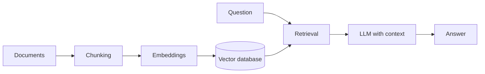
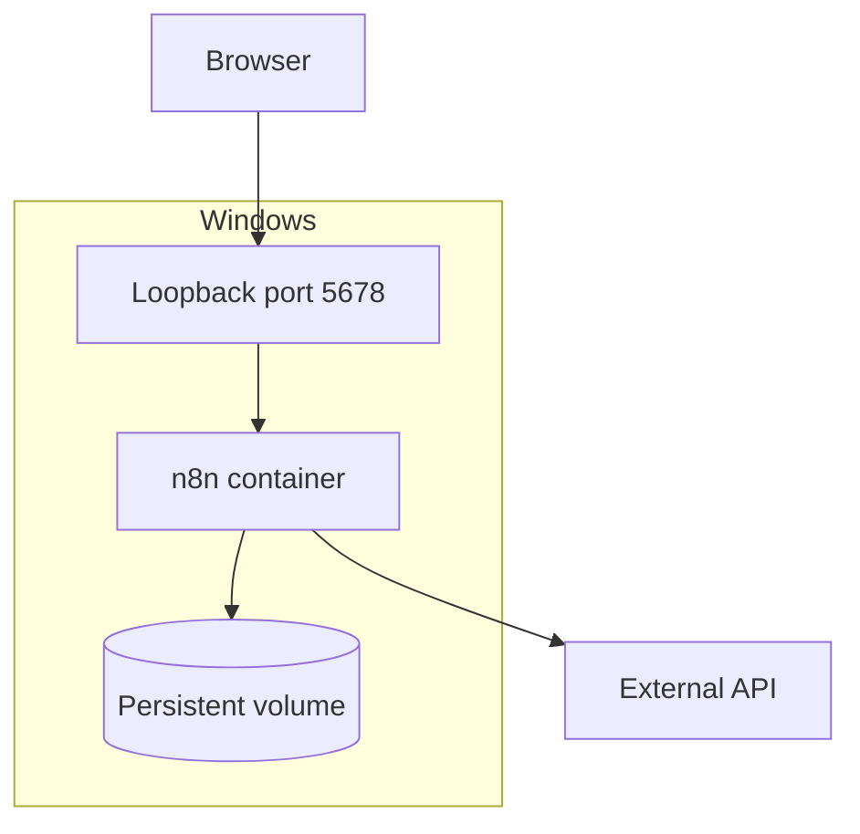
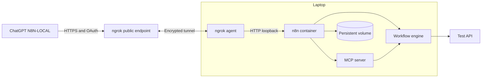
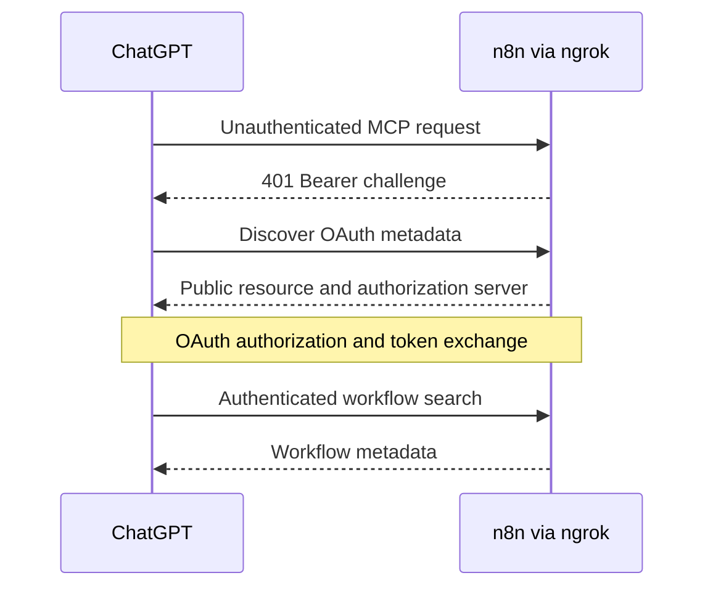
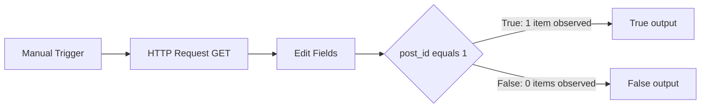
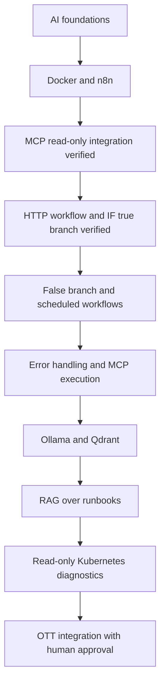

# AI Engineering Learning Lab

Updated: 2026-11-26

## Documentation index

- [n8n internal architecture and port troubleshooting](docs/n8n/n8n-internal-architecture.md)
- [Scheduled health monitoring, structured error handling and Gmail SMTP incident journal](docs/n8n/scheduled-health-monitoring-and-smtp.md)

Latest milestone: HTTP fault capture, endpoint recovery and SMTP authentication/send execution confirmed. Dynamic end-to-end alert, inbox receipt, retry behavior, IF False and automatic scheduling remain pending. See the continuation journal for exact evidence and security precautions.

## 1. Objective

Build a local AI automation and RAG platform for Kubernetes and OTT infrastructure operations. Use configurable values, least privilege, version-controlled documentation and human approval for remediation.

## 2. AI fundamentals

| Topic | Learning |
|---|---|
| LLM | Generates responses from supplied context |
| Automation | Executes predefined rules |
| Generative AI | Generates new content |
| Prompting | WHAT + CONTEXT + OUTPUT |
| Chunking | Splits documents into retrievable sections |
| Embeddings | Numeric semantic representations |
| RAG | Retrieves relevant knowledge before generation |
| Tool calling | Invokes external operations through defined interfaces |
| Agent | Uses a model to select tools and evaluate results |



RAG is a planned implementation; fundamentals have been covered.

## 3. Local infrastructure

| Component | Recorded version/configuration |
|---|---|
| Windows laptop | 32 GB RAM |
| Docker | 29.0.1 |
| Compose | 2.40.3-desktop.1 |
| WSL | 2.6.1.0 |
| n8n | 2.49.5 |
| ngrok | 3.39.13 |
| Workspace | D:\Kubernetes-Practice\AI-Infra |

### Installation and checks

```powershell
docker --version
docker compose version
wsl --version
docker ps
New-Item -ItemType Directory -Force D:\Kubernetes-Practice\AI-Infra\n8n
Set-Location D:\Kubernetes-Practice\AI-Infra\n8n
notepad compose.yaml
```

### Docker Compose

Reconstructed final configuration, with the actual public hostname replaced by an environment variable. Define N8N_PUBLIC_HOST in a locally stored, untracked .env file before using the tunnel configuration. For local-only initial setup, omit the public URL and reverse proxy settings.

```yaml
services:
  n8n:
    image: docker.n8n.io/n8nio/n8n:2.49.5
    container_name: n8n
    restart: unless-stopped
    ports:
      - "127.0.0.1:5678:5678"
    environment:
      TZ: Asia/Kolkata
      GENERIC_TIMEZONE: Asia/Kolkata
      N8N_ENFORCE_SETTINGS_FILE_PERMISSIONS: "true"
      N8N_UNVERIFIED_PACKAGES_ENABLED: "false"
      N8N_HOST: ${N8N_PUBLIC_HOST}
      N8N_PROTOCOL: https
      N8N_PORT: 5678
      N8N_EDITOR_BASE_URL: https://${N8N_PUBLIC_HOST}
      WEBHOOK_URL: https://${N8N_PUBLIC_HOST}/
      N8N_PROXY_HOPS: 1
    volumes:
      - n8n_data:/home/node/.n8n
volumes:
  n8n_data:
```

```powershell
docker compose config
docker compose pull
docker compose up -d
docker compose ps -a
docker logs n8n --tail 100
curl.exe http://localhost:5678/healthz
```

Observed: container Up; loopback port 5678; health response {"status":"ok"}. Volume n8n_n8n_data retained across recreation. Owner account created and editor accessible.



## 4. Ngrok and MCP integration

MCP enables ChatGPT to discover and invoke n8n tools. It is distinct from the model API; this OAuth connection did not require an OpenAI API key.



### Ngrok installation

winget was unavailable, so the official ZIP was used.

```powershell
New-Item -ItemType Directory -Force D:\Kubernetes-Practice\AI-Infra\ngrok
Set-Location D:\Kubernetes-Practice\AI-Infra\ngrok
Invoke-WebRequest -Uri "https://bin.equinox.io/c/bNyj1mQVY4c/ngrok-v3-stable-windows-amd64.zip" -OutFile ngrok.zip
Expand-Archive -Path .\ngrok.zip -DestinationPath . -Force
.\ngrok.exe version
.\ngrok.exe config add-authtoken <YOUR_ROTATED_TOKEN>
.\ngrok.exe config check
```

Assign the development hostname in ngrok, update Compose with the public URL settings above, then validate and recreate the container. Before public exposure, rotate previously exposed credentials and implement access restrictions. The following is the recorded startup command with hostname redacted; without additional policy it exposes the n8n editor publicly.

```powershell
.\ngrok.exe http --url=<YOUR_ASSIGNED_HOSTNAME> 5678
```

Observed online session, India region, approximately 20 ms reported latency, free plan. Keep the agent running in a separate window during tests. Local inspection interface: http://127.0.0.1:4040.

### Connectivity tests

```powershell
curl.exe -i http://localhost:5678/mcp-server/http
curl.exe http://localhost:5678/.well-known/oauth-protected-resource/mcp-server/http
curl.exe -i https://YOUR_HOST/healthz
curl.exe -i https://YOUR_HOST/mcp-server/http
curl.exe -i https://YOUR_HOST/.well-known/oauth-protected-resource/mcp-server/http
```

| Test | Observed |
|---|---|
| Local unauthenticated MCP | 401 Bearer challenge |
| Local OAuth discovery before proxy settings | localhost URLs |
| Local discovery after proxy settings | Public HTTPS resource and authorization server |
| Initial public health request | 404 ERR_NGROK_3200, endpoint offline |
| Public health after restarting tunnel | 200, {"status":"ok"} |
| Public MCP without token | 401, Authorization header not sent |
| Public OAuth discovery | 200, HTTPS resource and authorization server |
| Authenticated workflow search from ChatGPT | Success, one inactive workflow named My workflow |
| MCP workflow creation/execution | Pending; write tools unavailable |

### ChatGPT plugin

Open Plugins, Browse directory, Add, Add custom MCP server. Name: N8N-LOCAL. Connection: Server URL. URL: https://YOUR_HOST/mcp-server/http. Authentication: OAuth. Initially leave advanced discovery settings unchanged. Review the security warning, authorize only the trusted local instance and create the plugin. Installed version 1.0.0 was confirmed, and read-only workflow search returned one workflow. Keep read-only access for diagnostics unless write actions are specifically required and approved.



## 5. Practical workflow: 01-Basic-HTTP-Automation

All four nodes executed successfully in the editor. One item reached the True output.



### Step-by-step instructions

1. Create a workflow and name it 01-Basic-HTTP-Automation.
2. Add Manual Trigger (When clicking Execute workflow).
3. Add HTTP Request: GET https://jsonplaceholder.typicode.com/posts/1; authentication None. No headers, body or query parameters required.
4. Execute and inspect JSON: userId, id, title, body.
5. Add Edit Fields (Set), Manual Mapping. Configure the following recommended mappings.
6. Disable Include Other Input Fields.
7. Add IF with Number condition, expression for post_id, operator is equal to, comparison value 1.
8. Execute workflow, inspect both outputs and save.

| Field | Type | Expression |
|---|---|---|
| post_id | Number | `{{ $json.id }}` |
| user_id | Number | `{{ $json.userId }}` |
| post_title | String | `{{ $json.title }}` |

IF expression: `{{ $json.post_id }}`.

Expected transformed JSON:

```json
{
  "post_id": 1,
  "user_id": 1,
  "post_title": "sunt aut facere repellat provident occaecati"
}
```

Exact mappings and output values were not visible in the screenshots; the above is the instructed configuration, not an exported workflow.

### Test matrix

| Test | Expected | Status |
|---|---|---|
| Manual Trigger | 1 item | Pass |
| HTTP Request | 1 item | Pass |
| Edit Fields | 1 item | Pass |
| IF equals 1 | True branch 1 item | Pass |
| IF equals 2 | False branch 1 item | Pending |
| Schedule Trigger | Automatic execution | Configured in second workflow; execution pending |
| Error handling | Detect failed requests | Verified in second workflow |
| MCP write and execute | Create/run using authorized tools | Pending |

Negative test: change comparison value to 2, execute and confirm False output, then restore 1. Green node checks confirm execution success rather than all data values.

## 6. Troubleshooting

| Issue | Resolution or finding |
|---|---|
| Compose command from parent directory failed | cd into n8n or use docker compose -f .\n8n\compose.yaml ps -a |
| Python task runner unavailable | JavaScript runner registered; external Python runner deferred |
| Deprecated N8N_RUNNERS_ENABLED | Removed |
| winget unavailable | ZIP installation |
| OAuth advertised localhost | Applied HTTPS public host and proxy settings |
| Old cloud MCP search failed | Configured local connector separately |
| ERR_NGROK_3200 | Restart tunnel and keep its terminal running |
| MCP HTTP 401 | Expected for missing bearer token |
| MCP create/execute tools unavailable | Inspect permissions and OAuth scopes; manual workflow used |

## 7. Security and operational precautions

- Repository is public: never commit tokens, passwords, actual public hostname, .env, ngrok config, n8n data volumes or credentials.
- Bind Docker port to loopback. HTTPS and OAuth do not by themselves restrict every editor or API route.
- Rotation of previously exposed ngrok token and additional public endpoint hardening remain unconfirmed.
- Keep the tunnel online only when needed; protect the editor and limit exposed routes while preserving OAuth.
- Prefer least privilege and human approval; do not grant unrestricted production Kubernetes permissions.
- Pin versions, securely back up state, sanitize workflow exports and test upgrades.
- No production cluster operations have been executed in this lab workflow.

## 8. Roadmap



Future scenarios: NotReady nodes, pod restarts, certificate expiry, disk utilization and deployment failures. Start with synthetic input. Rule-based conditions are automation, not AI.

## 9. References

- [n8n docs](https://docs.n8n.io/)
- [Docker Compose](https://docs.docker.com/compose/)
- [ngrok docs](https://ngrok.com/docs/)
- [JSONPlaceholder](https://jsonplaceholder.typicode.com/)
- [GitHub diagrams](https://docs.github.com/en/get-started/writing-on-github/working-with-advanced-formatting/creating-diagrams)

This is a learning journal based on recorded commands, tool responses and screenshots. It is not a full workflow export or production deployment guide.
