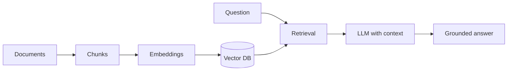

# AI and n8n Technical Definitions

Updated: 2026-11-26

A revision reference for concepts covered in the learning lab. Definitions are general technical explanations; implementation evidence is in the [README](../README.md) and [monitoring journal](n8n/scheduled-health-monitoring-and-smtp.md). Planned components are not claimed as deployed.

## 1. AI fundamentals

| Term | Definition | Practical example |
|---|---|---|
| Artificial intelligence (AI) | Systems performing tasks associated with human intelligence, such as language understanding and reasoning. | Summarize Kubernetes incident evidence. |
| Machine learning (ML) | Methods that learn patterns from data rather than relying entirely on explicit rules. | Learn anomaly patterns from metrics. |
| Generative AI | Models that generate content based on learned patterns and input context. | Generate an incident summary. |
| LLM | Large language model trained to process and generate language tokens. | Explain an error log. |
| Token | Unit of text processed by a model; not necessarily a whole word. | Split a log message into model input units. |
| Prompt | Instructions and context supplied to a model. | WHAT + CONTEXT + OUTPUT. |
| Context window | Maximum amount of tokenized context a model can process in a request, subject to model limits. | Include relevant runbook excerpts. |
| Inference | Running a trained model to produce an output. | Ask a local model to summarize an incident. |
| Hallucination | Plausible but unsupported or incorrect model output. | Inventing a nonexistent Kubernetes event. |
| Automation | Rule-driven execution of predefined tasks. | Check health every five minutes. |
| AI agent | System using a model to choose actions or tools toward a goal, within defined permissions. | Select read-only diagnostic commands. |
| Tool calling | Model requests a structured external operation; the host executes it and returns results. | Retrieve pod status. |
| Human-in-the-loop | Human review or approval at defined workflow stages. | Approve a proposed deployment restart. |

## 2. RAG and local AI (planned implementation)

| Term | Definition | Example |
|---|---|---|
| RAG | Retrieval-augmented generation: retrieve relevant information and provide it to a model before generation. | Retrieve certificate-expiry runbook before answering. |
| Chunking | Splitting documents into retrievable segments. | Divide a runbook by troubleshooting heading. |
| Embedding | Numeric vector representing input features or semantic meaning. | Encode a runbook paragraph. |
| Vector database | Database designed to store and search vectors, often with metadata. | Qdrant stores runbook embeddings. |
| Similarity search | Retrieve vectors close under a chosen metric. | Find related incident documentation. |
| Metadata | Descriptive attributes associated with records. | Cluster, document path, date. |
| Retrieval | Selecting relevant stored information for a query. | Return matching runbook chunks. |
| Grounding | Supporting model output with available evidence. | Cite actual error output. |
| Ollama | Local model management and inference runtime. | Run a supported LLM locally. |
| Qdrant | Vector search engine/database. | Store and retrieve document embeddings. |
| Fine-tuning | Further training model parameters for a task or behavior; distinct from RAG. | Adapt model behavior using training examples. |

## 3. n8n workflow terminology

| Term | Definition | Lab example |
|---|---|---|
| n8n | Workflow automation platform connecting triggers, actions and integrations. | Scheduled health monitoring. |
| Workflow | Connected nodes defining execution logic. | 02-Scheduled-Health-Monitoring. |
| Node | Individual trigger, action or processing step. | HTTP Request. |
| Trigger | Node that starts a workflow. | Manual Trigger or Schedule Trigger. |
| Manual Trigger | Starts an execution on user request. | Test workflow in editor. |
| Schedule Trigger | Starts published workflows at configured intervals or times. | Every five minutes. |
| Cron | Time-based scheduling expression. | */5 * * * * in five-field syntax. |
| Execution | One run of a workflow or selected nodes. | Manual fault test. |
| Item | Unit of data passed between nodes, typically containing JSON and optionally binary data. | One health response. |
| JSON | Structured text format for objects, arrays and values. | {"status":"ok"}. |
| Expression | Dynamic value evaluated using workflow context. | `{{ $json.status }}`. |
| $json | Current input item's JSON in an n8n expression. | Read error.code. |
| $now | Current date/time object in expression context. | `{{ $now.toISO() }}`. |
| Edit Fields (Set) | Node that creates or transforms item fields. | Capture HTTP Failure. |
| IF | Conditional node routing items to True or False outputs. | status equals ok. |
| Loop Over Items | Processes input items in batches. | Monitor endpoint inventory. |
| Credential | Stored authentication configuration referenced by nodes. | SMTP-Monitoring. |
| Publish | Make a workflow version available for production execution as applicable. | Enable scheduled monitoring after testing. |
| Webhook | HTTP endpoint that can receive events and trigger processing. | Future event-driven alerts. |
| Success output | Normal node output when execution succeeds. | Health JSON. |
| Error output | Separate output for failures when configured. | ECONNREFUSED item. |
| On Error | Node setting controlling failure behavior. | Continue using error output. |
| Retry On Fail | Reattempt failed node operations within configured limits. | Three total tries configured as lab instruction. |
| Timeout | Limit on waiting for an operation. | 5000 ms HTTP request setting. |
| Backoff | Delay between retry attempts, often increasing. | Avoid overwhelming failing service. |
| Idempotency | Repeating an operation has the same intended effect as doing it once. | Avoid duplicate incident creation. |
| Deduplication | Suppress repeated notifications for the same incident. | Planned alert state. |
| Recovery notification | Alert indicating a previously unhealthy service recovered. | Planned healthy transition email. |

## 4. Runtime and networking

| Term | Definition |
|---|---|
| Docker image | Packaged application and dependencies used to create containers. |
| Container | Isolated running application environment sharing the host kernel (through Linux VM on Windows Docker Desktop). |
| Docker Compose | Declarative configuration and management of multi-container applications. |
| WSL | Windows Subsystem for Linux; supports Linux environments on Windows. |
| Volume | Persistent storage managed separately from container lifecycle. |
| Port mapping | Publishes a container port through a host address/port. |
| Loopback | Local network interface, e.g. 127.0.0.1; scoped to its network namespace. |
| Network namespace | Isolation of interfaces, routes and sockets. |
| DNS | Resolves names to records such as IP addresses. |
| TCP | Reliable connection-oriented transport protocol. |
| Socket | Communication endpoint identified by protocol and address/port. |
| LISTEN | TCP socket state accepting incoming connections. |
| netstat | Utility for inspecting sockets and network connections. |
| /proc/net/tcp | Linux kernel interface exposing TCP socket information. |
| Task broker | Coordinates task execution with task runners in n8n. |
| Task runner | Executes supported code tasks; not every n8n node runs in a runner. |
| Scheduler | Starts scheduled workflow executions. |
| Execution engine | Coordinates node execution and item routing. |
| Reverse proxy | Intermediary forwarding incoming requests to backend services. |
| ngrok | Tunnel service connecting a public endpoint to a local service. |
| HTTPS | HTTP protected by TLS. |
| TLS | Protocol protecting data in transit and authenticating peers using certificates. |

Lab: 5678 main listener; 5679 observed internal listener, likely task broker (role not independently verified); 59999 unused during fault test. Docker DNS-related listener observed at 127.0.0.11. See architecture runbook for evidence.

## 5. HTTP and incident troubleshooting

| Term | Definition |
|---|---|
| HTTP | Application protocol for request/response communication. |
| REST API | API following REST architectural constraints, commonly using HTTP resources. |
| GET | HTTP method intended to retrieve a representation. |
| Endpoint | Address at which a service exposes an operation. |
| Health check | Probe used to evaluate service health. |
| HTTP 200 | Request succeeded at HTTP level; application payload may still indicate unhealthy status. |
| HTTP 400 | Bad request. |
| HTTP 401 | Missing or invalid authentication credentials. |
| HTTP 403 | Server refuses access. |
| HTTP 404 | Resource not found or not disclosed. |
| HTTP 429 | Too many requests. |
| HTTP 500 | Internal server error. |
| HTTP 503 | Service unavailable. |
| ECONNREFUSED | TCP connection rejected; no HTTP response received. |
| Timeout | Operation exceeded a configured time limit. |
| Fault injection | Controlled introduction of a failure to verify behavior. |
| RCA | Root cause analysis: identify underlying cause using evidence. |
| Stack trace | Call frames showing where an error propagated. |
| Observability | Ability to infer system state using telemetry such as logs, metrics and traces. |
| Independent monitoring | Monitoring from outside the monitored process or failure domain. |

## 6. MCP and authentication

| Term | Definition |
|---|---|
| MCP | Model Context Protocol, a standard for connecting AI applications to tools and contextual resources. |
| MCP client | Component that connects to an MCP server and uses its capabilities. |
| MCP server | Service exposing tools, resources or prompts through MCP. |
| OAuth | Authorization framework for delegated access using tokens. |
| Access token | Credential presented to access protected resources. |
| Bearer token | Token usable by its holder; must be protected. |
| OAuth discovery | Metadata describing protected resources or authorization servers. |
| Scope | Defined extent of requested or granted access. |
| Authentication | Establishing identity. |
| Authorization | Determining permitted actions. |
| Least privilege | Granting only permissions needed for a task. |
| API key | Secret or identifier used by an API for access control or client identification. |
| Secret rotation | Replacing credentials and revoking obsolete ones. |

MCP OAuth access is distinct from OpenAI model API billing. Read-only workflow search was verified; write and execution capability was not verified in the initial integration.

## 7. SMTP and email alerting

| Term | Definition |
|---|---|
| SMTP | Simple Mail Transfer Protocol, used to submit and relay email. |
| SMTP client | Software submitting mail to an SMTP server. |
| SMTP server | Service accepting and transferring mail. |
| SMTP AUTH | SMTP extension for client authentication. |
| Gmail SMTP | Google's mail submission service at smtp.gmail.com. |
| Port 465 | SMTP submission using implicit TLS. |
| Port 587 | SMTP submission commonly upgraded with STARTTLS. |
| STARTTLS | Command upgrading an existing plaintext protocol connection to TLS. |
| App Password | Google-generated application-specific credential for eligible accounts with two-step verification. |
| Two-step verification | Additional verification beyond a password for account sign-in. |
| EAUTH | Client-library authentication error classification. |
| SMTP 535 5.7.8 | Authentication credentials rejected by SMTP server. |
| From Email | Sender address; provider may restrict permitted sender identities. |
| To Email | Intended recipient address. |
| Mailpit | Local email capture/testing server; not real external delivery by default. |

Lab RCA: application label was incorrectly entered as SMTP User. Full Gmail address corrected authentication. App label is not the username. Never commit actual passwords or email credentials.

## 8. DevOps and future Kubernetes integration

| Term | Definition |
|---|---|
| Git | Distributed version control system. |
| GitHub | Hosting and collaboration platform for Git repositories. |
| Commit | Recorded snapshot/change in repository history. |
| Runbook | Operational instructions for a repeatable task or incident. |
| Kubernetes | Container orchestration platform. |
| RBAC | Role-based access control, assigning permissions through roles and bindings. |
| ServiceAccount | Kubernetes workload identity used for API authentication and other integrations. |
| Read-only diagnostics | Inspection operations without modifying cluster resources. |
| Remediation | Action correcting an identified issue. |
| CI/CD | Practices for integrating, testing and delivering software changes. |

## 9. Key distinctions for interviews

- Automation follows rules; AI agents may choose tools based on model reasoning. Basic health checks do not require an LLM.
- RAG retrieves context; fine-tuning changes model parameters.
- HTTP 200 does not guarantee application health.
- IF False is not the same as HTTP Error.
- TCP refusal is not HTTP 503.
- SMTP authentication success is not proof of inbox delivery.
- Credential creation is not credential assignment.
- Container loopback is not host loopback.
- TLS protects transport; OAuth delegates access; neither alone guarantees least privilege.

This glossary covers the concepts discussed so far plus closely related foundational terminology. Future lessons should extend it. No external source verification was performed for these general definitions.
