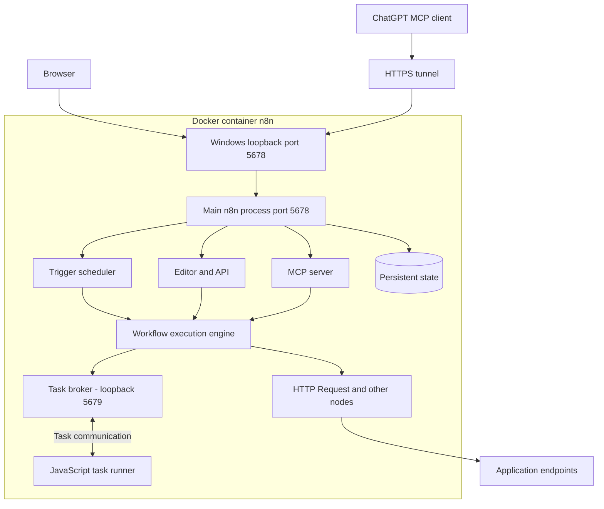
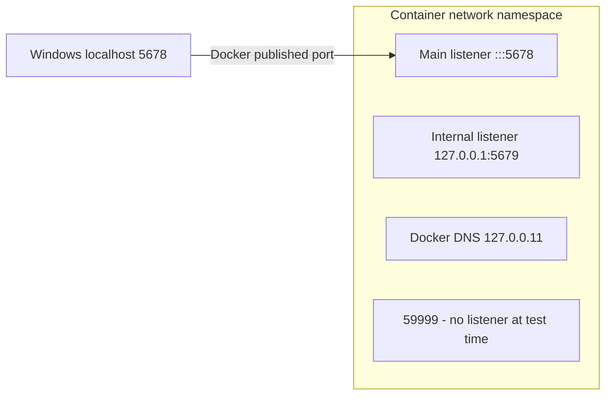
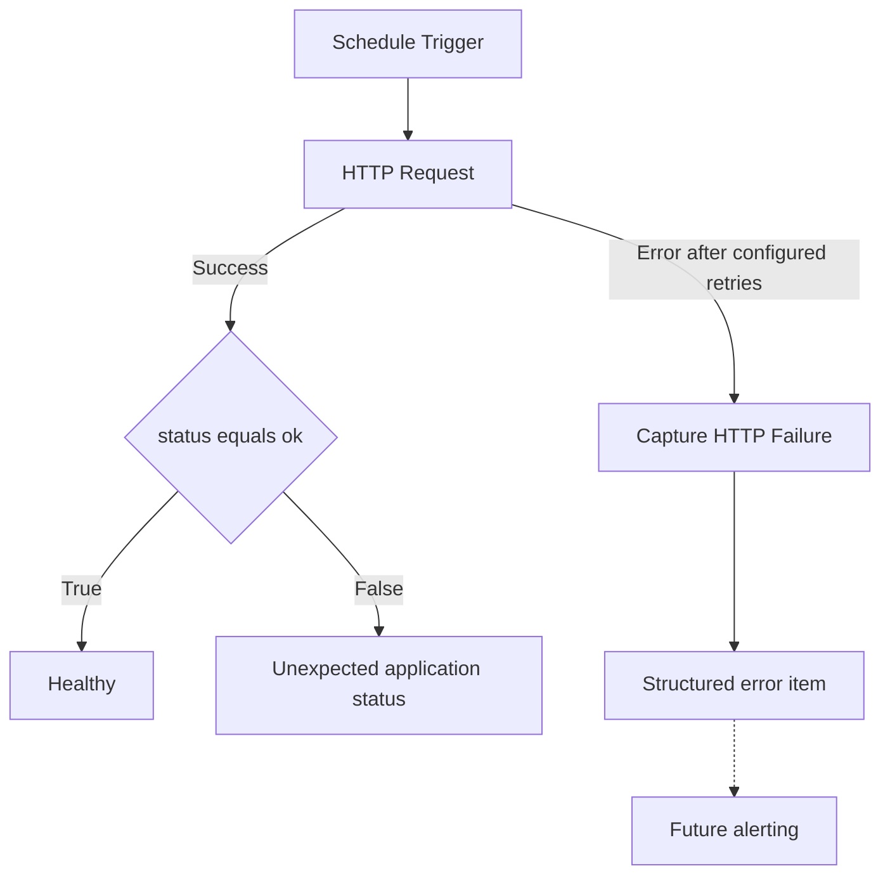

# n8n Internal Architecture and Troubleshooting

## 1. Purpose and scope

Understand the self-hosted n8n runtime, networking, task execution and HTTP failure handling before integrating AI agents with Kubernetes. This document records the lab observations of 25 November 2026. It distinguishes observed behavior from conceptual architecture.

## 2. Lab environment

| Component | Configuration |
|---|---|
| n8n | 2.49.5 |
| Runtime | Docker Desktop on Windows |
| Docker | 29.0.1 |
| Compose | 2.40.3-desktop.1 |
| Container | n8n |
| Host port mapping | 127.0.0.1:5678:5678 |
| Persistent volume | n8n_n8n_data |
| Container data directory | /home/node/.n8n |
| Timezone | Asia/Kolkata |

See the [lab README](../../README.md) for the Compose configuration and MCP setup.

## 3. Internal architecture



This is a conceptual component diagram, not a process trace. The main listener and second loopback listener were observed; the broker role is inferred from standard n8n task-runner configuration. The JavaScript runner was registered in earlier startup logs; Python runner availability was not established.

| Component | Responsibility |
|---|---|
| Main process | Hosts editor, APIs and regular-mode execution services |
| Scheduler | Starts published workflows according to configured schedules |
| Workflow engine | Executes connected nodes and routes items |
| Task broker | Coordinates supported code tasks with task runners |
| Task runner | Executes supported Code node tasks; not every workflow node runs here |
| Persistent state | Stores workflows, credentials and execution metadata according to configuration |
| MCP server | Exposes authorized tools to compatible clients |

## 4. Port and network architecture



| Address | Evidence | Interpretation |
|---|---|---|
| :::5678 | LISTEN, PID 7/n8n | Main application listener |
| 127.0.0.1:5679 | LISTEN, PID 7/n8n | Likely internal task broker |
| 127.0.0.11:45459 | LISTEN, process not shown | Docker embedded DNS-related listener |
| 127.0.0.1:59999 | ECONNREFUSED | No accepting TCP listener during test |

The host loopback and container loopback are different network namespaces. A port can be accessible inside a container without being published on the host. The broker should not be published merely to test it.

## 5. Incident: fault injection unexpectedly succeeded

### Expected behavior

The workflow 02-Scheduled-Health-Monitoring was designed to route successful HTTP responses to an IF node and failed requests to Capture HTTP Failure. Changing the URL from port 5678 to 5679 was expected to cause a connection refusal.

### Actual behavior

The HTTP Request and IF True branch executed successfully. The error branch did not execute. The initial assumption that 5679 was unused was incorrect.

### Diagnostic commands and results

Run from the Windows terminal:

```powershell
docker exec n8n node -e "fetch('http://127.0.0.1:5679/healthz').then(async r=>console.log(r.status,await r.text())).catch(e=>console.error(e.cause||e))"
```

Observed:

```text
200 {"status":"ok"}
```

```powershell
docker exec n8n sh -c "netstat -lntp"
```

Observed:

```text
Proto Recv-Q Send-Q Local Address      Foreign Address State  PID/Program name
tcp   0      0      127.0.0.11:45459  0.0.0.0:*       LISTEN -
tcp   0      0      127.0.0.1:5679    0.0.0.0:*       LISTEN 7/n8n
tcp   0      0      :::5678            :::*            LISTEN 7/n8n
```

```powershell
docker exec n8n sh -c "cat /proc/net/tcp /proc/net/tcp6"
```

Relevant observed socket fields (other connection rows omitted):

| File | local_address | st |
|---|---|---|
| /proc/net/tcp | 0B00007F:B193 | 0A |
| /proc/net/tcp | 0100007F:162F | 0A |
| /proc/net/tcp6 | 00000000000000000000000000000000:162E | 0A |

Hexadecimal 162F = 5679, 162E = 5678, B193 = 45459. TCP state 0A means LISTEN. The kernel output independently corroborates netstat.

```powershell
docker exec n8n node -e "fetch('http://127.0.0.1:59999/healthz',{signal:AbortSignal.timeout(5000)}).then(async r=>console.log(r.status,await r.text())).catch(e=>console.error(e.cause||e))"
```

Observed:

```text
Error: connect ECONNREFUSED 127.0.0.1:59999
errno: -111
code: ECONNREFUSED
syscall: connect
address: 127.0.0.1
port: 59999
```

### Root cause and corrective action

The fault injection targeted a live internal listener rather than an unused port. The successful HTTP response explains the Success branch. No n8n routing defect has been demonstrated. Port 59999 was validated as a replacement fault target; its availability must be rechecked if the environment changes.

## 6. Workflow failure handling



The branch connections and successful IF True execution were observed. The following are instructed lab settings; the exact timeout and retry values still require verification in the editor.

| Setting | Lab value |
|---|---|
| Schedule | Every 5 minutes |
| Normal URL | http://127.0.0.1:5678/healthz |
| Fault URL | http://127.0.0.1:59999/healthz |
| Timeout | 5000 ms |
| Retry On Fail | Enabled |
| Max Tries | 3 |
| Wait Between Tries | 2000 ms |
| On Error | Continue (using error output) |

Capture HTTP Failure uses Edit Fields with Manual Mapping and Include Other Input Fields disabled:

| Field | Type | Value |
|---|---|---|
| application | String | n8n |
| status | String | HTTP_REQUEST_FAILED |
| error_details | String | `{{ JSON.stringify($json) }}` |
| timestamp | String | `{{ $now.toISO() }}` |

Full error serialization is a lab-only diagnostic choice. Sanitize secrets before storing or forwarding error data.

### Remaining validation

- [x] Main application health verified.
- [x] Unexpected internal listener identified.
- [x] Alternative port connection refusal verified from container.
- [x] HTTP Success and Error connections configured.
- [ ] Execute workflow using port 59999.
- [ ] Verify retry configuration and behavior.
- [ ] Inspect structured error JSON and confirm IF is skipped.
- [ ] Restore port 5678 and verify recovery.
- [ ] Verify IF False with a controlled unhealthy response.
- [ ] Publish and verify automatic scheduling.
- [ ] Implement independent monitoring and alert delivery.

Do not publish with the fault URL configured.

## 7. Production considerations

- Use independent monitoring: a stopped n8n process cannot report its own outage.
- Distinguish HTTP transport errors, HTTP status failures and application-level health failures.
- Use bounded retries; avoid retrying permanent authentication errors indiscriminately.
- Keep internal broker ports private and use authenticated runner communication.
- Protect the editor and MCP endpoints, enforce least privilege, rotate exposed credentials and avoid committing public tunnel addresses or secrets.
- Persist and back up application state securely. For scale-out, evaluate PostgreSQL, Redis-backed queue mode and dedicated workers separately; these are not deployed in this lab.
- Keep versions pinned and test upgrades in a non-production environment.

## 8. References and limitations

- [n8n task runners](https://docs.n8n.io/hosting/configuration/task-runners/)
- [n8n task runner environment variables](https://docs.n8n.io/hosting/configuration/environment-variables/task-runners/)
- [n8n queue mode](https://docs.n8n.io/hosting/scaling/queue-mode/)
- [Docker port publishing](https://docs.docker.com/engine/network/port-publishing/)

These links are suggested further reading; their current contents were not independently retrieved for this document. The exact internal broker role remains an inference pending configuration or startup-log verification. No successful workflow fault-capture execution or automatic schedule is claimed yet.
