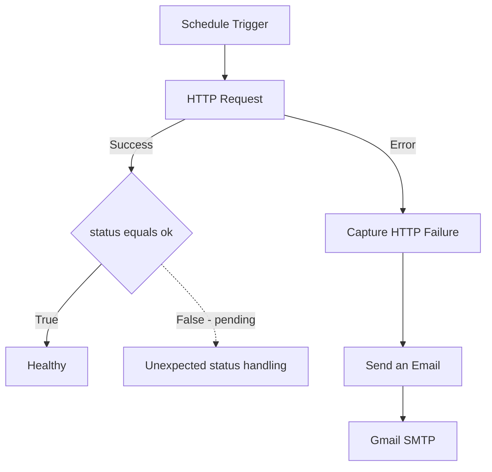
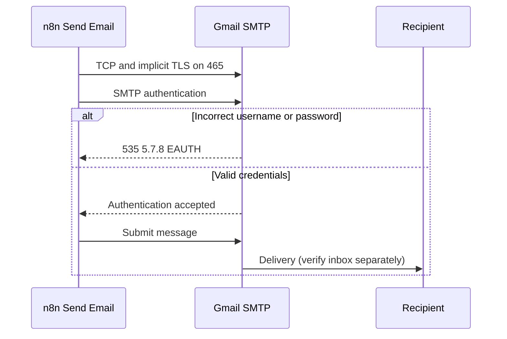

# n8n Scheduled Health Monitoring and Gmail SMTP — Implementation Journal

Updated: 2026-11-26 (IST)

## 1. Scope and prerequisites

This continues [AI foundations and installation](../../README.md) and [internal architecture and port diagnostics](n8n-internal-architecture.md). Environment: Windows, Docker 29.0.1, Compose 2.40.3-desktop.1, WSL 2.6.1.0, n8n 2.49.5 self-hosted, Asia/Kolkata, container n8n. Workflow: 02-Scheduled-Health-Monitoring. Earlier workflow 01-Basic-HTTP-Automation verified Manual Trigger, HTTP GET, Edit Fields and IF True. This journal distinguishes observed results from instructions and pending tests.

## 2. Lesson 5 — Schedule Trigger

For 100 endpoints, choose deterministic scheduling, configurable endpoint inventory, Loop Over Items, HTTP Request and error handling, not an LLM for basic health checks. Schedule Trigger supports intervals and cron; timezone matters. Every five minutes corresponds to five-field cron */5 * * * * (illustrative; interval UI used in lab).

1. Create workflow 02-Scheduled-Health-Monitoring.
2. Add Schedule Trigger, every 5 minutes.
3. Add HTTP Request, GET http://127.0.0.1:5678/healthz, authentication None.
4. Execute manually. Expected and observed: {"status":"ok"}.
5. Remove duplicate trigger/request pair shown in initial editor screenshot; retain working pair. Suggested names Schedule Trigger and Check Application Health; exact final names not confirmed.
6. Connect Success to IF, String expression `{{ $json.status }}`, is equal to, fixed value ok.
7. One item on True branch was observed. False branch and automatic scheduling not yet verified.

Self-monitoring is a lab exercise: if n8n stops, it cannot send its own alert. Production requires independent monitoring.

## 3. Lesson 6 — HTTP failure handling

Correct scenario answer: B, bounded timeout, limited retries and error handling. Configure HTTP Request Parameters > Options > Timeout 5000 ms; Settings > Retry On Fail ON, Max Tries 3 (total attempts), Wait Between Tries 2000 ms, On Error Continue (using error output). Exact retry execution not verified. Illustrative upper request/wait budget 3 x 5 + 2 x 2 = 19 seconds, excluding overhead. Avoid indiscriminate retries of permanent errors.

| Failure | Interpretation |
|---|---|
| 400 | Invalid request |
| 401 | Authentication required/failed |
| 403 | Authorization denied |
| 404 | Resource not found |
| 429 | Rate limit; consider Retry-After |
| 500/503 | Server failure/unavailable |
| ECONNREFUSED | TCP connection rejected; no HTTP response |
| Timeout | Request exceeded time budget |
| DNS failure | Name resolution failed |

Initially Edit Fields was attached to IF False instead of HTTP Error. Remove incorrect connection and connect HTTP Request Error directly to Edit Fields; rename Capture HTTP Failure. IF False is a separate application-health condition and still needs handling.



## 4. Fault injection and port diagnostics

Changing 5678 to 5679 unexpectedly returned 200 {"status":"ok"} and IF True. See the [full commands, netstat and kernel socket evidence](n8n-internal-architecture.md#5-incident-fault-injection-unexpectedly-succeeded). Main listener :::5678, internal listener 127.0.0.1:5679 (likely task broker, not independently proven), Docker DNS-related listener 127.0.0.11:45459. PID 7/n8n owned both n8n listeners. Hex ports 162E and 162F; TCP state 0A LISTEN. Container loopback differs from Windows loopback.

```powershell
docker exec n8n node -e "fetch('http://127.0.0.1:5679/healthz').then(async r=>console.log(r.status,await r.text())).catch(e=>console.error(e.cause||e))"
docker exec n8n sh -c "netstat -lntp"
docker exec n8n sh -c "cat /proc/net/tcp /proc/net/tcp6"
docker exec n8n node -e "fetch('http://127.0.0.1:59999/healthz',{signal:AbortSignal.timeout(5000)}).then(async r=>console.log(r.status,await r.text())).catch(e=>console.error(e.cause||e))"
```

Last command returned ECONNREFUSED, errno -111, syscall connect, address 127.0.0.1, port 59999. Use http://127.0.0.1:59999/healthz as controlled failure URL only after confirming no listener.

## 5. Actual workflow error and structured mapping

At 2026-11-26T00:07:46.330+05:30 the HTTP Error output contained the following relevant fields (stack omitted, not a verbatim full export):

```json
{
  "timestamp": "2026-11-26T00:07:46.330+05:30",
  "error": {
    "message": "connect ECONNREFUSED 127.0.0.1:59999",
    "name": "Error",
    "code": "ECONNREFUSED"
  },
  "details": {
    "message": "The service refused the connection - perhaps it is offline",
    "httpCode": "ECONNREFUSED",
    "body": null,
    "context": {"itemIndex": 0}
  }
}
```

Stack referenced Axios/n8n backend. This is a transport failure, not an HTTP status code. Initial Edit Fields mapping used application=n8n, status=HTTP_REQUEST_FAILED, error_details=`{{ JSON.stringify($json) }}`, timestamp=`{{ $now.toISO() }}`. Do not recreate the existing node; edit it. Full error serialization is noisy and may expose secrets.

Final mapping (case-sensitive field names matching actual output), Manual Mapping, Include Other Input Fields OFF:

| Field | Type | Value |
|---|---|---|
| Application | String | N8N |
| Status | String | HTTP_REQUEST_FAILED |
| timestamp | String | `{{ $now.toISO() }}` (or source timestamp if preserving event time) |
| error_code | String | `{{ $json.error.code }}` |
| error_message | String | `{{ $json.error.message }}` |
| description | String | `{{ $json.details.message }}` |

Actual user-reported output:

```json
[
  {
    "Application": "N8N",
    "Status": "HTTP_REQUEST_FAILED",
    "timestamp": "2026-11-26T00:26:21.308+05:30",
    "error_code": "ECONNREFUSED",
    "error_message": "connect ECONNREFUSED 127.0.0.1:59999",
    "description": "The service refused the connection - perhaps it is offline"
  }
]
```

Restored port 5678; actual output [{"status":"ok"}]. Recovery of endpoint verified; IF True and skipped error branch on that specific run not independently confirmed.

## 6. Lesson 7 — Alerting options and selection

| Option | Purpose |
|---|---|
| Gmail SMTP | Real email, personal Gmail with App Password if eligible |
| Telegram Bot | Chat alerts |
| Slack / Teams | Team collaboration alerts |
| PagerDuty | Incident escalation |
| Discord webhook | Chat notifications |
| Mailpit | Local SMTP capture for lab, no real external delivery |

Gmail SMTP chosen as initial implementation when user requested start without selecting provider. No separate SMTP account purchase required. Mailpit remains an alternative. Add Send an Email after Capture HTTP Failure; resource Email, operation Send. Do not publish with fault URL.

## 7. Gmail SMTP setup

1. Open https://myaccount.google.com/security and enable 2-Step Verification.
2. Open https://myaccount.google.com/apppasswords under the same Google account used for SMTP.
3. Create app label n8n-monitoring (label may be arbitrary).
4. Copy newly generated 16-character App Password without display spaces. Never use normal Gmail password, verification code or app label as authentication credential.
5. In Send an Email > Parameters > Credential to connect with, create or select existing SMTP-Monitoring credential. Save and test.

| Field | Correct value |
|---|---|
| User | Complete personal Gmail address (redacted) |
| Password | Newly generated Google App Password (redacted) |
| Host | smtp.gmail.com |
| Port | 465 |
| SSL/TLS | ON |
| Client Host Name | Empty |

Alternative diagnostic configuration discussed: port 587, implicit SSL/TLS OFF, Disable STARTTLS OFF. STARTTLS upgrades the connection; changing port does not fix invalid credentials. Not confirmed tested.



## 8. SMTP incident chronology and RCA

All times IST, 26 November 2026 unless stated. n8n node type n8n-nodes-base.emailSend, node version 2.1, resource email, operation send, binaryDataMode filesystem, n8n 2.49.5 Self Hosted.

| Event | Evidence / action |
|---|---|
| Initial setup | Node does not have any credentials set; instructed to create/select credential |
| User reported no SMTP account | Explained existing Gmail App Password option and alternatives |
| First Gmail failure | Invalid login: 535-5.7.8 Username and Password not accepted |
| 01:22:57 | NodeOperationError: Node does not have any credentials set |
| Credential discovery | User confirmed SMTP-Monitoring exists; select explicitly |
| Repeated SMTP test | 535-5.7.8 again; authentication not successful |
| 02:01:09 | NodeApiError, httpCode EAUTH, same SMTP response |
| App Password discussion | User exposed a password; advised revoke immediately and generate new; actual value deliberately excluded |
| 02:27:16 | NodeApiError EAUTH, same SMTP response |
| Account type | Personal Gmail, not corporate Workspace |
| Security verification | 2-Step Verification confirmed; same-account match, revocation, whitespace removal and blocked sign-in checks initially not confirmed |
| Screenshot inspection | User field contained n8n_monitoring, host smtp.gmail.com, port 465, SSL/TLS enabled, password masked |
| Corrective action | Replace app label in User with complete Gmail address; advised fresh App Password |
| Resolution | User confirmed success both ways (credential connection and Send Email execution in context) |

### Error 1 — missing credentials

```text
NodeOperationError: Node does not have any credentials set
ExecuteContext._getCredentials (node-execution-context.ts:417:12)
ExecuteContext.getCredentials (base-execute-context.ts:129:21)
ExecuteContext.execute (send.operation.ts:190:33)
```

Failure before SMTP connection. Existing credential must be assigned to node; existence alone is insufficient.

### Error 2 — rejected authentication

```text
Invalid login: 535-5.7.8 Username and Password not accepted
https://support.google.com/mail/?p=BadCredentials
httpCode: EAUTH
NodeApiError
ExecuteContext.execute (send.operation.ts:304:10)
EmailSendV2.node.ts:110:17
WorkflowExecute.executeNode (workflow-execute.ts:1164:8)
WorkflowExecute.runNode (workflow-execute.ts:1466:11)
```

Repeated server session identifiers and redundant stack frames omitted; these are diagnostic excerpts, not full raw logs. Gmail response proves server reached and authentication rejected, not a Docker or ngrok issue. Screenshot revealed actual misconfiguration: app label n8n_monitoring used as SMTP User. Corrected to full Gmail address. Password validity and rotation cannot be inferred from masked field. User-reported success confirms resolution of authentication and send execution; inbox receipt and full failure workflow not independently verified. No Docker restart, firewall change or reinstall required.

## 9. Dynamic alert template — instructed, pending validation

Use existing Send an Email node with SMTP-Monitoring selected. From Email = authenticated Gmail address; To Email = intended recipient. Email Format Text. Subject and Message in Expression mode.

Subject:

```text
🚨 ALERT: {{ $json.Application }} - {{ $json.Status }}
```

Message:

```text
INFRASTRUCTURE MONITORING ALERT

Application: {{ $json.Application }}
Status: {{ $json.Status }}
Timestamp: {{ $json.timestamp }}

Error Code: {{ $json.error_code }}
Error Message: {{ $json.error_message }}
Description: {{ $json.description }}

Action Required:
Please investigate the application availability.

Regards,
Infrastructure Monitoring Automation
```

Fields are case-sensitive. Use incoming structured item from Capture HTTP Failure. Avoid hardcoding personal addresses in Git; configure recipient per environment. For multiple endpoints, pass application name and URL from inventory rather than fixed N8N.

## 10. Validation matrix and next steps

| Test | Status |
|---|---|
| Manual HTTP healthy endpoint | Verified |
| IF True initial healthy execution | Verified |
| 5679 fault injection unexpectedly healthy | Verified |
| 59999 connection refusal from container | Verified |
| HTTP Error output with ECONNREFUSED | Verified |
| Structured error item | Verified |
| Restore 5678 health response | Verified |
| Gmail credential connection | User confirmed successful |
| Send Email node execution | User confirmed successful |
| Actual email inbox receipt | Not independently confirmed |
| Dynamic alert template and end-to-end fault email | Pending |
| Healthy workflow produces no email | Pending |
| Exact retry count and wait behavior | Pending |
| IF False application-level failure | Pending |
| Automatic schedule publication/execution | Pending |
| Recovery notifications and duplicate suppression | Planned |
| Independent monitoring and multi-endpoint inventory | Planned |
| Ollama, Qdrant, RAG, Kubernetes read-only agent | Planned |

Next: set fault URL 59999, manually execute full workflow, verify structured email in inbox, restore 5678, confirm no failure email, then handle IF False and verify retries. Publish only with healthy URL and controlled alert policy. Add incident state, deduplication, recovery alerts, backoff and separate notification-failure handling before production. Never use LLM for deterministic health checks; AI can later summarize incidents using sanitized context.

## 11. Security and documentation boundaries

Previously exposed Google App Password and ngrok token must be revoked/rotated; completion not confirmed. Do not commit passwords, personal email addresses, tokens, public tunnel hostname, .env, credential exports or n8n persistent data. Restrict editor/MCP exposure, use least privilege, and keep secrets in credential storage. No live workflow export or complete raw log archive was available for this journal; it captures recorded commands, configuration, error excerpts, user confirmations and known limitations. References: [Google App Passwords](https://support.google.com/accounts/answer/185833), [n8n SMTP credentials](https://docs.n8n.io/integrations/builtin/credentials/sendemail/). Links are further reading, not independently checked during this update.
